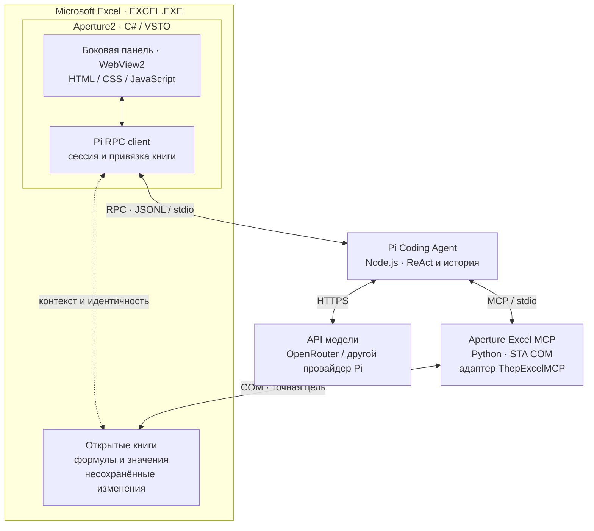

# Aperture2

Личный harness для управления живым Microsoft Excel через [Pi Coding Agent](https://github.com/earendil-works/pi). Чат находится в боковой панели **C# / VSTO**, инструменты работают с открытой книгой и её несохранёнными изменениями. Первый сценарий — анализ и аудит финансовой модели. PowerPoint и Word остаются следующими этапами.

## Статус

Первая техническая версия, 14 октября 2026 года. Собраны настоящая VSTO-надстройка, асинхронный клиент Pi RPC и MCP-адаптер с 10 инструментами на базе выбранных операций ThepExcelMCP. Upstream подключён через закреплённые Git submodules и не изменён.

На этой машине проверены сборка, загрузка VSTO и WebView2-панели внутри Excel, реальные чтение/запись/пересчёт/чтение результата в несохранённой книге и запрос через `openrouter/free`: модель вызвала инструменты, прочитала формулу `=SUM(A1:A2)` и вернула 42. Исправлена ошибка доступа к UI из фонового потока после запуска Pi. Пользовательская приёмка панели и качества аудита остаётся за пользователем.

Приватный прототип пользователя с 40+ инструментами не является зависимостью. Позже его можно подключить через MCP-адаптер; совместимость без исходников не проверена. Оболочка и доступные здесь инструменты собираются самостоятельно.

## Запуск

Нужны Windows, настольный Excel, Microsoft Edge WebView2 Runtime, Visual Studio 2022 с нагрузкой «Разработка для Office/SharePoint» и .NET Framework 4.8 targeting pack, а также Node.js ≥22.19, Python 3.12 и Git в `PATH`. Здесь проверены Excel Microsoft 365 x64, VS 2022 Community 17.14, Node 24.18 и Python 3.12. VSTO-проект собирает только MSBuild из Visual Studio; `dotnet build` для него не подходит.

1. Открой `Aperture2.sln` и выполни **Build → Build Solution** (или сразу **F5**). Первая сборка сама:
   - получает закреплённые submodules `external/pi` и `external/thepexcel`;
   - собирает Pi (`npm ci`, `npm run build`) и создаёт `.venv` для Excel MCP — нужна сеть, занимает несколько минут;
   - подписывает VSTO локальным сертификатом и регистрирует надстройку для текущего пользователя.

   Повторные сборки пропускают подготовку зависимостей, пока не изменятся закреплённые ревизии submodules или `requirements.lock.txt` (метки лежат в `.local\deps`). Логика — в [build/Aperture.Dependencies.targets](build/Aperture.Dependencies.targets) и [build/Aperture.Signing.targets](build/Aperture.Signing.targets).
2. Один раз авторизуй Pi: из корня репозитория выполни `node external\pi\packages\coding-agent\dist\bundle\cli.js`, в его интерфейсе введи `/login openrouter` и выйди.
3. **F5** запускает отдельный Excel (`excel /x`) с отладчиком; `Aperture.Excel` — стартовый проект по умолчанию. После сборки надстройка загружается и в обычном Excel. Вкладка **Aperture2 → Панель Aperture2** показывает чат. Открой тестовую книгу, проверь её имя в панели и отправь: «Прочитай структуру книги и формулы A1:D20 на Лист1. Пока ничего не меняй».

Уже работающий Excel не заменяет загруженную версию при пересборке. Для отдельного обычного экземпляра можно выполнить `excel /x` через Win+R и открыть книгу в нём.

Если сборка выдаёт `MSB3061` для `WebView2Loader.dll`, посмотри указанный в предупреждении PID: даже после закрытия окна старый Excel может оставаться в фоне и удерживать DLL. Сначала сохрани нужные книги и закрой относящийся к ним Excel, затем повтори сборку. Не завершай все процессы Excel вслепую. Исчезновение вкладки само по себе ещё не доказывает ошибку сборки; live smoke ниже проверяет автозагрузку в новом экземпляре без принудительного подключения надстройки.

Кнопка привязки выбирает текущую книгу для чата; переключение активной книги не перенаправляет уже привязанный чат. После Save As или закрытия/повторного открытия книги явно обнови привязку. «Новый чат» создаёт новую сессию. «Стоп» прерывает запрос Pi; уже выполняющаяся COM-запись может завершиться, автоматического отката нет.

**Подпись и регистрация.** VSTO загружает только подписанные manifests. Debug-сборка находит или один раз создаёт неэкспортируемый сертификат `CN=Aperture2 Development` в CurrentUser\My, подписывает им VSTO и регистрирует надстройку вместе с её manifest inclusion entry. Ключи не входят в Git, общие настройки доверия Office и Trusted Root не меняются. В csproj вместо отпечатка стоит метка `Aperture2-Development`: когда это свойство пустое, Visual Studio перед сборкой создаёт свой `*_TemporaryKey.pfx` и переписывает проект. **Build → Clean Solution** снимает регистрацию и запись доверия; `.venv`, собранный Pi и история чатов остаются.

Это developer-установка; установщика для распространения пока нет. Release-сборка требует настоящего сертификата: `/p:ManifestCertificateThumbprint=<отпечаток>`.

## Модель и провайдер

Первый запуск: **Provider `openrouter`**, **Model `openrouter/free`**. Их можно изменить в настройках панели; уже сохранённые настройки не перезаписываются. Pi хранит авторизацию в стандартном `%USERPROFILE%\.pi\agent`. Ключ не нужно передавать в чат или сохранять в репозиторий. Альтернатива — `OPENROUTER_API_KEY` в окружении процесса Excel; после изменения переменных среды может потребоваться новый запуск Excel.

Первый API smoke прошёл; повторный выявил ошибку итогового ответа при правильных результатах инструментов. В том прогоне free router также менял фактическую модель между шагами. Успешное подключение не гарантирует качество анализа; подробности обоих прогонов сохранены в [отчёте проверки](docs/verification.md).

| Вариант | Применение | Ограничение |
| --- | --- | --- |
| OpenRouter `openrouter/free` | Бесплатный старт; роутер учитывает поддержку инструментов | Модель может меняться между запросами |
| Конкретная модель OpenRouter `:free` | Более повторяемые аудиты после сравнения качества | Каталог меняется; нужна поддержка tool calling |
| Groq, например `openai/gpt-oss-120b` | Альтернативный провайдер, поддерживаемый Pi | Лимит токенов в минуту может мешать объёмным аудитам |

По [документации OpenRouter](https://openrouter.ai/docs/api_reference/limits), проверенной 14 октября 2026: бесплатные модели ограничены 20 запросами/минуту и обычно 50 запросами/день без покупки кредитов на $10; после этого порога — 1000/день. Покупка для старта не нужна. Один диалог агента может использовать несколько API-запросов на шаги ReAct. [Free router](https://openrouter.ai/openrouter/free/) выбирает совместимую бесплатную модель; для стабильных сравнений лучше закреплять конкретную.

Данные прочитанных диапазонов передаются выбранному API. Для реальных финансовых моделей учитывай [настройки приватности OpenRouter](https://openrouter.ai/docs/guides/privacy/provider-logging) и [политику Groq](https://console.groq.com/docs/your-data). Бесплатный Gemini сейчас не выбран: [условия unpaid services](https://ai.google.dev/gemini-api/terms#unpaid-services) отдельно ограничивают передачу конфиденциальных данных. Наличие модели в каталоге Pi не означает, что ключ настроен и API доступен.

## Архитектура



VSTO, панель и RPC-клиент находятся **внутри Excel**, книги принадлежат приложению. Pi запускается по требованию; MCP — его дочерний stdio-сервер. Pi выполняет весь агентный цикл. RPC обслуживает разговор, MCP — инструменты. Отдельного HTTP-сервера или второго агентного движка нет.

Чат отображается в WebView2, встроенном в WinForms-контрол task pane; файлы интерфейса локальны (`src/Aperture.Excel/Web`). Markdown, включая таблицы, обновляется прямо во время стриминга. Ход работы развёрнут по умолчанию: каждый вызов инструмента виден отдельной строкой от формирования аргументов до результата, включая повторные вызовы одного инструмента. Аргументы, результаты и полученные от провайдера reasoning-блоки раскрываются отдельно. Отсутствующие события не выдумываются: один инструмент в истории действительно может означать только один вызов. C# получает только разрешённые команды чата через `postMessage`; COM-объекты и авторизация в JavaScript не передаются. Диалог настроек пока нативный WinForms. Обращения к книге и интерфейсу после асинхронных операций явно возвращаются на UI-поток: наличие `SynchronizationContext` в Excel не предполагается.

По одному Pi на чат; для одного процесса Excel разрешён один активный агентный запрос. COM выполняется последовательно в STA. Backend получает PID/HWND Excel, HWND окна книги и `excelInstanceId`/`workbookId`, проверяет процесс, захватывает COM-объект книги и проверяет его идентичность перед операциями. Он не создаёт Excel и не заменяет открытую книгу файлом с диска.

Windows Job Object управляет только дочерними Pi/MCP-процессами; Excel в job не включён. У чата отдельные cwd, MCP-конфигурация и история. Для Excel-чата отключены обычные shell/file tools Pi, сторонние extensions и глобальные MCP-серверы. Флаг Pi `--offline` отключает обновление каталога моделей, а не запросы к LLM.

Backend можно заменить на C# MCP или адаптер к приватным инструментам без изменения канала чата. Для исполнения внутри VSTO понадобится локальный транспорт; сейчас внешний COM-backend его не требует. [Исходное сравнение вариантов и трудозатрат](docs/tooling-choice.md).

## Инструменты

| Инструмент | Возможность |
| --- | --- |
| `excel_target` | Идентификаторы, структура и состояние книги |
| `excel_read_range` | Значения Value2 и точные Formula2, постраничное чтение |
| `excel_find` | Поиск в формулах или значениях диапазона |
| `excel_names` | Именованные диапазоны и выражения |
| `excel_write_values` | Пакетная запись прямоугольника значений |
| `excel_write_formula` | Запись Formula2 с английскими именами функций |
| `excel_recalculate` | Пересчёт указанного листа |
| `excel_add_sheet` | Добавление нового листа, например для отчёта |
| `excel_format` | Числовой формат, жирность/цвет, заливка, автоширина |
| `excel_operation_status` | Проверка результата после тайм-аута |

Операции требуют явной цели. До 10 000 ячеек на страницу чтения/блок записи. Формулы возвращаются полностью; строковые значения upstream reader ограничивает 500 символами, это обозначено в ответе. Даты — серийные числа Excel; ошибки значений — коды Excel. При ручном расчёте межлистовые зависимости требуют пересчёта соответствующих листов и чтения результата.

Обычные изменения выполняются по запросу в чате. **Аудит сам по себе не разрешает исправлять исходную модель.** Удаление, закрытие и другие рискованные действия требуют подтверждения; в первой версии такие инструменты не опубликованы. Нет сохранения, VBA, запуска кода или shell из Excel-чата. Автоматического Undo/отката нет. Глобальные `Calculation`, `ScreenUpdating`, `EnableEvents`, `DisplayAlerts` инструменты не переключают.

`excel_target` даёт перечень листов, границы диапазонов и метаданные; он не читает формулы и не доказывает связи между листами. Инструкция новым сессиям требует подтверждать выводы о расчётах и зависимостях чтением конкретных ячеек, обозначать предположения и границы выборки. Это инструкция модели, а не гарантия полноты аудита.

Тайм-аут COM не означает отмену записи. До сверки запрещён слепой повтор: `excel_operation_status` сообщает состояние и результат предыдущего вызова. После потери соединения сначала восстанови привязку и прочитай изменяемый диапазон.

## Проверки

Сначала собери решение (Debug) в Visual Studio, затем:

```powershell
.\scripts\test.ps1        # backend, протокол/lifecycle runtime и тест панели
.\scripts\test.ps1 -Live  # дополнительно настоящий Excel + VSTO + MCP + Pi RPC
# Отдельно: реальный API и вызовы инструментов моделью, нужны учётные данные Pi
.\.venv\Scripts\python.exe tools\LocalSmoke\run.py --model-smoke
```

Тест панели — проект `PaneLifecycleHarness` в папке решения `tests`; его можно запустить и из Visual Studio (**Debug → Start Without Debugging** на этом проекте). Код возврата 0 означает успех.

Live smoke открывает отдельный видимый Excel и собственные книги. Проверяет загрузку VSTO/панель, записывает 20 и 22, получает `=SUM(A1:A2)` → 42 через MCP и подтверждает несохранённое состояние. Проверяет привязку при активной второй книге, неизменность её контрольных ячеек и обзор книги с chart sheet. Pi проверяется без запроса к модели: RPC, подключение MCP и каталог инструментов. Только свои тестовые книги закрываются без сохранения. JSON-отчёты: `.local/smoke/`, вне Git.

Флаг `--model-smoke` дополнительно отправляет запрос через `openrouter/free` без платного fallback, проверяет реальные `excel_target`/`excel_read_range` и ответ модели. Значения, формулы тестового диапазона и состав листов сравниваются до и после запроса. Обе WebView2-панели должны подтвердить загрузку HTML. Обычные тесты не обращаются к API.

Отдельная [проверка HTML-интерфейса](tests/web/README.md) проверяет рендер до завершения стрима, ход работы и команды панели; сохраняет скриншоты без обращения к Excel или модели.

Smoke не доказывает качество LLM, визуальное удобство панели или полноту аудита: это пользовательская приёмка после настройки API. Автовосстановление прежнего чата после перезапуска Excel, полноценное Undo, установщик и подтверждения для будущих рискованных инструментов пока не реализованы.

Подробные результаты и ограничения, включая очистку фонового тестового Excel после `Quit`: [отчёт технической проверки](docs/verification.md).

## Структура и локальные данные

| Путь | Содержимое |
| --- | --- |
| `src/Aperture.Excel` | VSTO, WebView2-чат в WinForms task pane, Ribbon, привязка книги |
| `build` | MSBuild-цели: подготовка Pi/Python и подпись Debug-сборки |
| `src/Aperture.Runtime` | .NET Framework 4.8 клиент Pi RPC и lifecycle |
| `src/aperture_mcp` | MCP-адаптер, точная COM-привязка и каталог |
| `external/pi` | Pi 1.2.0, git `9fe3f371622cad9cc1a3cbf044288abd0252192f` |
| `external/thepexcel` | ThepExcelMCP 0.2.2, git `bd3aac3e188c3f1277f8694b12b00c128db773db` |
| `tests`, `tools` | Тесты backend/runtime/панели и live smoke |

Настройки: `%LOCALAPPDATA%\Aperture2\settings.json`. Истории Pi и привязки: `%LOCALAPPDATA%\Aperture2\sessions`. Профиль WebView2: `%LOCALAPPDATA%\Aperture2\webview2`. Логи VSTO: `%LOCALAPPDATA%\Aperture2\logs` (без промптов и содержимого ячеек). Истории сессий могут содержать данные книг; они локальны и не включаются в Git. Авторизация остаётся в стандартном хранилище Pi.

Лицензии: [THIRD_PARTY_NOTICES.md](THIRD_PARTY_NOTICES.md). Инструкции для агентов: [AGENTS.md](AGENTS.md).
