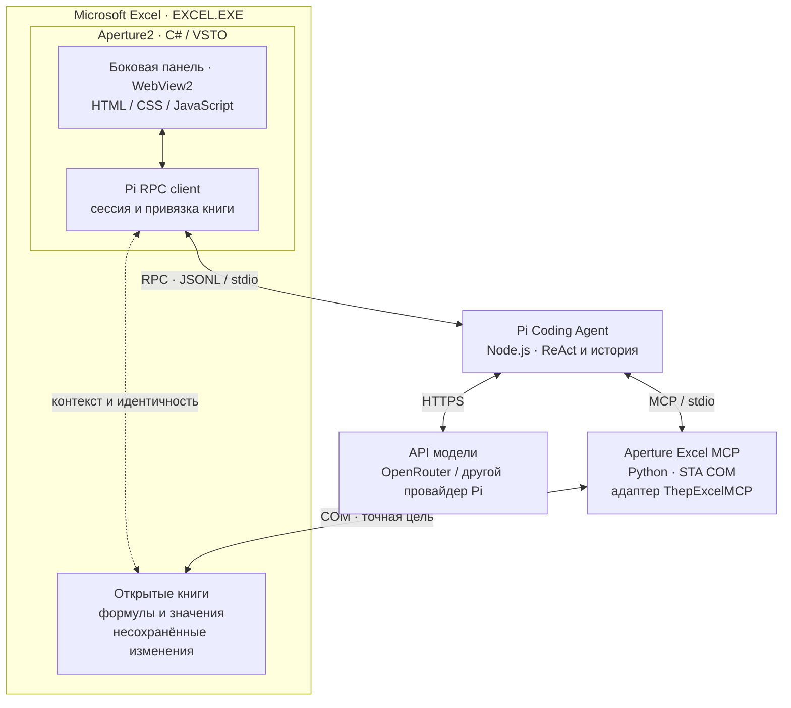

# Aperture2

Личный harness для управления живым Microsoft Excel через [Pi Coding Agent](https://github.com/earendil-works/pi). Чат находится в боковой панели **C# / VSTO**, инструменты работают с открытой книгой и её несохранёнными изменениями. Первый сценарий — анализ и аудит финансовой модели. PowerPoint и Word остаются следующими этапами.

## Статус

Первая техническая версия, 14 октября 2026 года. Собраны настоящая VSTO-надстройка, асинхронный клиент Pi RPC и MCP-адаптер с 10 инструментами на базе выбранных операций ThepExcelMCP. Upstream подключён через закреплённые Git submodules и не изменён.

На этой машине проверены сборка, загрузка VSTO и WebView2-панели внутри Excel, реальные чтение/запись/пересчёт/чтение результата в несохранённой книге и запрос через `openrouter/free`: модель вызвала инструменты, прочитала формулу `=SUM(A1:A2)` и вернула 42. Исправлена ошибка доступа к UI из фонового потока после запуска Pi. Пользовательская приёмка панели и качества аудита остаётся за пользователем.

26 октября 2026 добавлены пользовательский провайдер RouterAI и [COM-вход для скриптов](#управление-чатом-из-скриптов): другой процесс запускает, опрашивает и останавливает обычный чат панели.

Также 26 октября по решению пользователя панель открывается только кнопкой на вкладке «Главная», как Claude и ChatGPT for Excel; в шапке остались только «Новый чат» и настройки (заголовок «Aperture2» даёт сама область задач Excel), из нижнего блока убрана строка статуса. После первого сохранения или Save As чат сам продолжает работу с той же книгой под новым именем. Эти изменения пока проверены тестом панели, браузерным тестом и проверкой продолжения истории на настоящем Pi с локальным фиктивным провайдером; в живом Excel (сборка VSTO, `excel /x`) проверено только, что кнопка открывает и скрывает панель, продолжение после Save As — нет. У кнопки и свёрнутой группы своя иконка — зелёная диафрагма из прежней шапки чата (PNG-ресурс сборки через `loadImage`): встроенная `imageMso` на тёмной ленте Microsoft 365 не рисовалась. На тёмной ленте пользователя иконка видна с прозрачным фоном; светлая лента в Excel не проверялась.

27 октября по просьбе пользователя в ленте стало видно сжатие контекста Pi: раньше панель молчала, пока Pi больше минуты сжимал историю, и запрос выглядел зависшим. Проверено браузерным тестом, тестом панели и закреплённым Pi в RPC-режиме с локальным фиктивным провайдером: Pi сжал контекст по порогу после `agent_end` и до `agent_settled`, с повтором запроса сводки, а записанные события отрисованы настоящим `chat.html` в Edge. В живом Excel не проверено.

Тогда же, тоже по просьбе пользователя, переделан показ обрывов связи и повторов запроса: вместо красной плашки с сырым «terminated» — жёлтое «Обрыв соединения с провайдером», пока Pi повторяет запрос; подпись повтора показывается целиком, с номером попытки и задержкой; рассуждение оборванной попытки помечено как прерванное. Проверено браузерным тестом; в живом Excel — нет.

По решению пользователя панель показывает и ответ, оборванный по лимиту длины. Повод — случай из бенчмарка: модель писала реестр прямо в рассуждении и упёрлась в `maxTokens`. Pi закончил ход, а панель показала пустой ответ без объяснений. Теперь на месте обрыва стоит плашка, а если запрос на нём закончился, это видно по карточке. Проверено браузерным тестом на синтетических событиях по контракту закреплённого Pi; на настоящем Pi и в живом Excel не проверено.

Тогда же по решению пользователя в системный промпт добавлены общие правила длинной задачи, не только аудита:
- длинный результат писать в книгу по ходу работы, частями примерно по 5–10 строк за вызов, а не составлять большие таблицы и списки в рассуждении;
- если запись отклонена или завершилась ошибкой, повторить её меньшими частями, а после тайм-аута сначала проверить, применилась ли она;
- промежуточная запись не завершает задачу: перед концом сверить требования запроса;
- рассуждать коротко, потому что у каждого ответа есть жёсткий лимит вывода, а оборванный ответ теряет работу;
- закончить краткой самопроверкой.

Автопродолжение хода синтетическим сообщением после обрыва по длине пользователь отверг. Оборванный ответ только показывается в панели. Как модели работают с новыми правилами, не проверялось.

Приватный прототип пользователя с 40+ инструментами не является зависимостью. Позже его можно подключить через MCP-адаптер; совместимость без исходников не проверена. Оболочка и доступные здесь инструменты собираются самостоятельно.

## Запуск

Нужны Windows, настольный Excel, Microsoft Edge WebView2 Runtime, Visual Studio 2022 с нагрузкой «Разработка для Office/SharePoint» и .NET Framework 4.8 targeting pack, а также Node.js ≥22.19, Python 3.12 и Git в `PATH`. Здесь проверены Excel Microsoft 365 x64, VS 2022 Community 17.14, Node 24.18 и Python 3.12. VSTO-проект собирает только MSBuild из Visual Studio; `dotnet build` для него не подходит.

1. Открой `Aperture2.sln` и выполни **Build → Build Solution** (или сразу **F5**). Первая сборка сама:
   - получает закреплённые submodules `external/pi` и `external/thepexcel`;
   - собирает Pi (`npm ci`, `npm run build`) и создаёт `.venv` для Excel MCP — нужна сеть, занимает несколько минут;
   - подписывает VSTO локальным сертификатом и регистрирует надстройку для текущего пользователя.

   Повторные сборки пропускают подготовку зависимостей, пока не изменятся закреплённые ревизии submodules или `requirements.lock.txt` (метки лежат в `.local\deps`). Логика — в [build/Aperture.Dependencies.targets](build/Aperture.Dependencies.targets) и [build/Aperture.Signing.targets](build/Aperture.Signing.targets).
2. Один раз авторизуй Pi: из корня репозитория выполни `node external\pi\packages\coding-agent\dist\bundle\cli.js`, в его интерфейсе введи `/login openrouter` и выйди.
3. **F5** запускает отдельный Excel (`excel /x`) с отладчиком; `Aperture.Excel` — стартовый проект по умолчанию. После сборки надстройка загружается и в обычном Excel. Сама панель не открывается: открой тестовую книгу, нажми **Главная → Aperture2** (своя группа в конце вкладки, кнопка с зелёной диафрагмой) и отправь: «Прочитай структуру книги и формулы A1:D20 на Лист1. Пока ничего не меняй». Та же кнопка скрывает и снова показывает панель этого окна.

Уже работающий Excel не заменяет загруженную версию при пересборке. Для отдельного обычного экземпляра можно выполнить `excel /x` через Win+R и открыть книгу в нём.

Если сборка выдаёт `MSB3061` для `WebView2Loader.dll`, посмотри указанный в предупреждении PID: даже после закрытия окна старый Excel может оставаться в фоне и удерживать DLL. Сначала сохрани нужные книги и закрой относящийся к ним Excel, затем повтори сборку. Не завершай все процессы Excel вслепую. Исчезновение группы Aperture2 с «Главной» само по себе ещё не доказывает ошибку сборки; live smoke ниже проверяет автозагрузку в новом экземпляре без принудительного подключения надстройки.

У каждого окна книги своя панель, и чат привязан к книге этого окна; переключение активной книги его не перенаправляет. Имени книги и кнопки перепривязки в панели нет. После первого сохранения или Save As книга остаётся той же (тот же объект и окно, те же `excelInstanceId`/`workbookId`), меняются имя и путь: следующее сообщение перезапускает Pi и MCP с новой целью и продолжает ту же историю Pi. Закрытое окно убирает свою панель; книгу, недоступную по захваченному объекту, чат не подменяет и сообщает ошибку. «Новый чат» создаёт новую сессию и, если чат потерял книгу, заново привязывает книгу своего окна. «Стоп» прерывает запрос Pi; уже выполняющаяся COM-запись может завершиться, автоматического отката нет.

**Подпись и регистрация.** VSTO загружает только подписанные manifests. Debug-сборка находит или один раз создаёт неэкспортируемый сертификат `CN=Aperture2 Development` в CurrentUser\My, подписывает им VSTO и регистрирует надстройку вместе с её manifest inclusion entry. Ключи не входят в Git, общие настройки доверия Office и Trusted Root не меняются. В csproj вместо отпечатка стоит метка `Aperture2-Development`: когда это свойство пустое, Visual Studio перед сборкой создаёт свой `*_TemporaryKey.pfx` и переписывает проект. **Build → Clean Solution** снимает регистрацию и запись доверия; `.venv`, собранный Pi и история чатов остаются.

Это developer-установка; установщика для распространения пока нет. Release-сборка требует настоящего сертификата: `/p:ManifestCertificateThumbprint=<отпечаток>`.

## Модель и провайдер

Первый запуск: **Provider `openrouter`**, **Model `openrouter/free`**. Их можно изменить в настройках панели; уже сохранённые настройки не перезаписываются. Pi хранит авторизацию в стандартном `%USERPROFILE%\.pi\agent`. Ключ не нужно передавать в чат или сохранять в репозиторий. Альтернатива — `OPENROUTER_API_KEY` в окружении процесса Excel; после изменения переменных среды может потребоваться новый запуск Excel.

Первый API smoke прошёл; повторный выявил ошибку итогового ответа при правильных результатах инструментов. В том прогоне free router также менял фактическую модель между шагами. Успешное подключение не гарантирует качество анализа; подробности обоих прогонов сохранены в [отчёте проверки](docs/verification.md).

| Вариант | Применение | Ограничение |
| --- | --- | --- |
| OpenRouter `openrouter/free` | Бесплатный старт; роутер учитывает поддержку инструментов | Модель может меняться между запросами |
| Конкретная модель OpenRouter `:free` | Более повторяемые аудиты после сравнения качества | Каталог меняется; нужна поддержка tool calling |
| Groq, например `openai/gpt-oss-120b` | Альтернативный провайдер, поддерживаемый Pi | Лимит токенов в минуту может мешать объёмным аудитам |

По [документации OpenRouter](https://openrouter.ai/docs/api_reference/limits), проверенной 14 октября 2026: бесплатные модели ограничены 20 запросами/минуту и обычно 50 запросами/день без покупки кредитов на $10; после этого порога — 1000/день. Покупка для старта не нужна. Один диалог агента может использовать несколько API-запросов на шаги ReAct. [Free router](https://openrouter.ai/openrouter/free/) выбирает совместимую бесплатную модель; для стабильных сравнений лучше закреплять конкретную.

Данные прочитанных диапазонов передаются выбранному API. Для реальных финансовых моделей учитывай [настройки приватности OpenRouter](https://openrouter.ai/docs/guides/privacy/provider-logging) и [политику Groq](https://console.groq.com/docs/your-data). Бесплатный Gemini сейчас не выбран: [условия unpaid services](https://ai.google.dev/gemini-api/terms#unpaid-services) отдельно ограничивают передачу конфиденциальных данных. Наличие модели в каталоге Pi не означает, что ключ настроен и API доступен.

### Свой OpenAI-совместимый провайдер

Провайдер, которого нет в каталоге Pi (агрегатор RouterAI, внутренний API компании), описывается в `%USERPROFILE%\.pi\agent\models.json` (или `%PI_CODING_AGENT_DIR%\models.json`). Код Aperture2 для этого не меняется. Ключ в файл не пишется: `apiKey` ссылается на переменную окружения (`$ИМЯ`), и Pi подставляет её из своего окружения в момент запроса. Пример — RouterAI, проверенный 26 октября 2026:

```json
{
  "$schema": "https://pi.dev/schemas/models.schema.json",
  "providers": {
    "routerai": {
      "name": "RouterAI",
      "baseUrl": "https://routerai.ru/api/v1",
      "api": "openai-completions",
      "apiKey": "$ROUTERAI_API_KEY",
      "compat": { "supportsStore": false, "supportsDeveloperRole": false, "maxTokensField": "max_tokens", "thinkingFormat": "openrouter" },
      "models": [
        {
          "id": "deepseek/deepseek-v4.1-flash", "name": "DeepSeek V4.1 Flash (RouterAI)", "reasoning": true,
          "thinkingLevelMap": { "off": "none", "minimal": null, "low": "low", "medium": null, "high": "high", "xhigh": null, "max": "max" },
          "input": ["text"], "contextWindow": 1048576, "maxTokens": 65536,
          "cost": { "input": 6.1846012371, "output": 24.7384049484, "cacheRead": 0.123692024742, "cacheWrite": 0 },
          "compat": { "requiresReasoningContentOnAssistantMessages": true }
        },
        {
          "id": "qwen/qwen3.8-27b", "name": "Qwen3.8 27B (RouterAI)", "reasoning": true,
          "thinkingLevelMap": { "off": "none", "minimal": null, "low": "low", "medium": "medium", "high": null, "xhigh": "xhigh", "max": null },
          "input": ["text"], "contextWindow": 1000000, "maxTokens": 65536,
          "cost": { "input": 2.0939906, "output": 52.349765, "cacheRead": 0.94229577, "cacheWrite": 0 }
        }
      ]
    }
  }
}
```

- Ключ задаётся один раз пользовательской переменной (`setx ROUTERAI_API_KEY <ключ>`). Она доходит только до новых процессов, а Excel, запущенный через COM, получает окружение входа в систему и не видит её до следующего входа. Поэтому переменные, на которые ссылается `models.json` (`$ИМЯ`, `${ИМЯ}`) и которых нет в окружении Excel, Aperture2 берёт из пользовательского (затем машинного) окружения и передаёт только процессу Pi; значение нигде не записывается. Без переменной Pi не показывает модели провайдера: `node external\pi\packages\coding-agent\dist\bundle\cli.js --offline --list-models` выводит `routerai` только при заданном ключе.
- Точные id моделей — из `GET https://routerai.ru/api/v1/models`. RouterAI повторяет API OpenRouter (`reasoning: {effort}`, `reasoning_details`, `usage.cost`, поле `provider` с выбранным апстримом), поэтому `compat` повторяет описание этих моделей в каталоге Pi для OpenRouter: `thinkingFormat: "openrouter"`, без роли `developer` и поля `store`, лимит ответа — `max_tokens`. DeepSeek в многоходовом диалоге с инструментами требует `reasoning_content` в сообщениях ассистента. `thinkingLevelMap` переводит уровни Pi в `reasoning.effort`; `null` — уровня нет, и Pi берёт соседний. Pi по умолчанию просит `medium`, для DeepSeek V4.1 Flash получается `high`. Карта Qwen перенесена из каталога OpenRouter и с RouterAI не проверялась.
- `cost` — ставки за миллион токенов; Pi умножает на них токены и показывает как оценку. Для RouterAI ставки взяты из `/models` в рублях (валюта в ответе не указана, на сайте цены в рублях). Фактическое списание RouterAI бывает выше ставки каталога: 26.10.2026 запросы DeepSeek V4.1 Flash шли через апстрим BytePlus и стоили в 2,8 раза дороже. В историю Pi попадает только оценка по ставкам: `usage.cost` из ответа провайдера Pi отбрасывает, точную сумму запроса даёт RouterAI (`GET /api/v1/generation?id=…`). Ставки — снимок на дату проверки.
- Usage: для `openai-completions` Pi всегда просит `stream_options.include_usage` и кладёт токены в `usage` сообщения ассистента (`message_end`). Для RouterAI проверено, что prompt/completion/cached/reasoning доходят до событий и истории Pi.

Внутренний API подключается так же: свой `baseUrl`, `"api": "openai-completions"`, `"apiKey": "$INTERNAL_LLM_API_KEY"` и `models` с id, которые принимает этот API. `compat` добавляй только после проверки, что эндпоинт отличается от OpenAI (не принимает роль `developer`, `store`, `max_completion_tokens` и т. п.), а `cost` — если известны ставки:

```json
"internal": {
  "baseUrl": "https://llm.example.corp/v1",
  "api": "openai-completions",
  "apiKey": "$INTERNAL_LLM_API_KEY",
  "models": [{ "id": "internal-model", "contextWindow": 131072, "maxTokens": 16384 }]
}
```

Панель берёт провайдера и модель из своих настроек; выбрать там RouterAI — Provider `routerai`, Model `deepseek/deepseek-v4.1-flash`.

## Архитектура



VSTO, панель и RPC-клиент находятся **внутри Excel**, книги принадлежат приложению. Pi запускается по требованию; MCP — его дочерний stdio-сервер. Pi выполняет весь агентный цикл. RPC обслуживает разговор, MCP — инструменты. Отдельного HTTP-сервера или второго агентного движка нет.

Чат отображается в WebView2, встроенном в WinForms-контрол task pane; файлы интерфейса локальны (`src/Aperture.Excel/Web`). Каждый запрос — одна хронологическая лента: текст модели, рассуждения и вызовы инструментов стоят в порядке событий Pi (по `contentIndex` внутри сообщения), промежуточные ответы — между шагами, к которым относятся. Подряд идущие шаги собраны в компактную группу; каждый вызов инструмента — отдельная строка от формирования аргументов до результата, включая повторные вызовы одного инструмента. Аргументы, результаты и полученные от провайдера reasoning-блоки раскрываются отдельно. Сжатие контекста Pi (`compaction_start/end`) — тоже шаг карточки своего запроса: Pi сжимает перед промптом, между ходами или после `agent_end`, но всегда до `agent_settled`. Пока оно идёт, строка «Сжимаю контекст…» с крутилкой называет причину (контекст близок к пределу или переполнен) и повтор запроса сводки; по окончании та же строка показывает «Контекст сжат», длительность и объём токенов до сжатия, если Pi его сообщил, либо «Сжатие не удалось» с ошибкой Pi или «Сжатие прервано». В подробностях — точные числа Pi и сводка, которую он оставил. Неудавшееся сжатие не делает запрос ошибкой, а сжатие после ответа не отнимает у него роль итогового. Ошибка провайдера — плашка в ленте: обрыв потока, который Pi повторяет (`terminated`, `Connection error.`, `Network connection lost.` и другие сетевые тексты из его списка повторяемых), называется «Обрыв соединения с провайдером», исходный текст стоит под заголовком мелко. Недоступный провайдер выглядит так же: для него OpenAI SDK отдаёт тот же `Connection error.`, что проверено на закреплённом Pi. «Нет соединения с провайдером» появляется, только если в исходном тексте есть системная ошибка вроде `ECONNREFUSED` или `ENOTFOUND`; остальные ошибки (лимиты, перегрузка, ключ) показываются своим текстом. Пока Pi может восстановиться, плашка жёлтая; красной она становится, только если запрос закончился с этой ошибкой, например когда повторы не помогли. Каждый повтор (`auto_retry_start`) — строка «Повтор 2 из 8 через 30 с» с крутилкой на время ожидания; рассуждение и текст оборванной попытки (её сообщение закончилось с `stopReason: "error"`, Pi исключает его из контекста модели) помечены как прерванные. Ответ, оборванный по лимиту выходных токенов (`stopReason: "length"`), получает после своего частичного содержимого плашку «Ответ оборван: достигнут лимит длины ответа». Под заголовком — число выведенных токенов, если Pi сообщил `usage.output`, и сколько вызовов не исполнено. Рассуждение или текст, на котором оборвался поток, помечены «оборвано», но не зачёркнуты: Pi оставляет такой ответ в контексте. Вызовы из оборванного ответа Pi не исполняет, потому что их аргументы могли оборваться. Он возвращает по каждому ошибку и продолжает работу, а их карточки получают состояние «не исполнен» с пояснением. Если Pi продолжил после обрыва (следующий ответ или сжатие с повтором), плашка остаётся жёлтой; попытку, которую Pi повторяет после сжатия, он исключает из контекста, поэтому она помечена как прерванная. Если ход закончился на оборванном ответе, плашка красная, карточка называется «Ответ оборван», итогового ответа и кнопки «Копировать» нет. Заголовок запроса показывает текущее действие и время; щелчок по нему сворачивает ход работы, оставляя итоговый ответ. Markdown (таблицы, списки, цитаты, разделители `---`) обновляется прямо во время стриминга. Строки статуса под полем ввода нет: текущий шаг, время и число действий показывает карточка запроса, а «Стоп» на месте «Отправить» — что работа идёт. Ошибки, неподтверждённая остановка, неизвестный итог запроса и заметки панели стоят в ленте: в карточке идущего запроса или отдельной строкой; та же строка подряд не повторяется. Строки stderr Pi в ленту не выводятся: последние из них поясняют ошибку, если агент завершился. Тема панели следует явно выбранной теме Office, иначе теме Windows. Отсутствующие события не выдумываются: один инструмент в истории действительно может означать только один вызов. C# получает только разрешённые команды чата через `postMessage`; COM-объекты и авторизация в JavaScript не передаются. Диалог настроек пока нативный WinForms. Обращения к книге и интерфейсу после асинхронных операций явно возвращаются на UI-поток: наличие `SynchronizationContext` в Excel не предполагается.

По одному Pi на чат; для одного процесса Excel разрешён один активный агентный запрос. COM выполняется последовательно в STA. Backend получает PID/HWND Excel, HWND окна книги и `excelInstanceId`/`workbookId`, проверяет процесс и перед каждой операцией находит книгу по имени, пути и HWND её окна; после закрытия/повторного открытия или Save As книга не подменяется. Новое имя той же книги после Save As панель берёт только из захваченного объекта книги в том же окне и передаёт новому MCP на следующем запросе; Pi открывает прежний файл истории (`--session`) и записывает изменённую строку привязки как обновление системного промпта. Между операциями backend не держит COM-ссылок на Excel: иначе после закрытия Excel пользователем процесс оставался бы скрытым из-за ссылок убитого MCP. Backend не создаёт Excel и не заменяет открытую книгу файлом с диска.

Windows Job Object управляет только дочерними Pi/MCP-процессами; Excel в job не включён. У чата отдельные cwd, MCP-конфигурация и история. Для Excel-чата отключены обычные shell/file tools Pi, сторонние extensions и глобальные MCP-серверы. Флаг Pi `--offline` отключает обновление каталога моделей, а не запросы к LLM.

Backend можно заменить на C# MCP или адаптер к приватным инструментам без изменения канала чата. Для исполнения внутри VSTO понадобится локальный транспорт; сейчас внешний COM-backend его не требует. [Исходное сравнение вариантов и трудозатрат](docs/tooling-choice.md).

## Инструменты

| Инструмент | Возможность |
| --- | --- |
| `excel_target` | Идентификаторы, структура и состояние книги |
| `excel_read_range` | Значения Value2 и точные Formula2, постраничное чтение |
| `excel_find` | Поиск в формулах или значениях диапазона |
| `excel_names` | Именованные диапазоны и выражения |
| `excel_write_values` | Пакетная запись прямоугольника значений |
| `excel_write_formula` | Запись Formula2 с английскими именами функций |
| `excel_recalculate` | Пересчёт указанного листа |
| `excel_add_sheet` | Добавление нового листа, например для отчёта |
| `excel_format` | Числовой формат, жирность/цвет, заливка, автоширина |
| `excel_operation_status` | Проверка результата после тайм-аута |

Операции требуют явной цели. До 10 000 ячеек на страницу чтения/блок записи. Формулы возвращаются полностью; строковые значения upstream reader ограничивает 500 символами, это обозначено в ответе. Даты — серийные числа Excel; ошибки значений — коды Excel. При ручном расчёте межлистовые зависимости требуют пересчёта соответствующих листов и чтения результата.

Обычные изменения выполняются по запросу в чате. **Аудит сам по себе не разрешает исправлять исходную модель.** Удаление, закрытие и другие рискованные действия требуют подтверждения; в первой версии такие инструменты не опубликованы. Нет сохранения, VBA, запуска кода или shell из Excel-чата. Автоматического Undo/отката нет. Глобальные `Calculation`, `ScreenUpdating`, `EnableEvents`, `DisplayAlerts` инструменты не переключают.

`excel_target` даёт перечень листов, границы диапазонов и метаданные; он не читает формулы и не доказывает связи между листами. Инструкция новым сессиям требует подтверждать выводы о расчётах и зависимостях чтением конкретных ячеек, обозначать предположения и границы выборки. Это инструкция модели, а не гарантия полноты аудита. Та же инструкция просит перед каждой группой вызовов коротко написать видимым текстом, что уже установлено и что проверяется дальше; некоторые модели free router пишут только рассуждение, поэтому промежуточных сообщений может не быть.

Тайм-аут COM не означает отмену записи. До сверки запрещён слепой повтор: `excel_operation_status` сообщает состояние и результат предыдущего вызова. После потери соединения сначала восстанови привязку и прочитай изменяемый диапазон.

## Проверки

Сначала собери решение (Debug) в Visual Studio, затем:

```powershell
.\scripts\test.ps1        # backend, runtime, тест панели и браузерный тест UI (если есть Playwright)
.\scripts\test.ps1 -Live  # дополнительно настоящий Excel + VSTO + MCP + Pi RPC
# Отдельно: реальный API и вызовы инструментов моделью, нужны учётные данные Pi
.\.venv\Scripts\python.exe tools\LocalSmoke\run.py --model-smoke
```

Тест панели — проект `PaneLifecycleHarness` в папке решения `tests`; его можно запустить и из Visual Studio (**Debug → Start Without Debugging** на этом проекте). Код возврата 0 означает успех.

Live smoke открывает отдельный видимый Excel и собственные книги. Проверяет загрузку VSTO и то, что панель не открывается сама ни при запуске, ни при переключении книг. Проверяет отказ `StartWithThinking` с неизвестным уровнем (панель при этом не открывается). Затем открывает панели обеих книг через `Start` и `StartWithThinking(…, "high")` с немедленным `Cancel`: запуск Pi отменяется до отправки промпта, запроса к модели нет, и smoke проверяет, что история Pi не появилась. Записывает 20 и 22, получает `=SUM(A1:A2)` → 42 через MCP и подтверждает несохранённое состояние. Проверяет привязку при активной второй книге, неизменность её контрольных ячеек и обзор книги с chart sheet. Pi проверяется без запроса к модели: RPC, подключение MCP и каталог инструментов. Только свои тестовые книги закрываются без сохранения. JSON-отчёты: `.local/smoke/`, вне Git.

Флаг `--model-smoke` дополнительно отправляет запрос через `openrouter/free` без платного fallback, проверяет реальные `excel_target`/`excel_read_range` и ответ модели. Значения, формулы тестового диапазона и состав листов сравниваются до и после запроса. Обе WebView2-панели должны подтвердить загрузку HTML. Обычные тесты не обращаются к API.

Отдельная [проверка HTML-интерфейса](tests/web/README.md) проверяет рендер до завершения стрима, ход работы и команды панели; сохраняет скриншоты без обращения к Excel или модели.

Smoke не доказывает качество LLM, визуальное удобство панели или полноту аудита: это пользовательская приёмка после настройки API. Автовосстановление прежнего чата после перезапуска Excel, полноценное Undo, установщик и подтверждения для будущих рискованных инструментов пока не реализованы.

Подробные результаты и ограничения, включая очистку фонового тестового Excel после `Quit`: [отчёт технической проверки](docs/verification.md).

## Управление чатом из скриптов

Надстройка отдаёт COM-объект `Application.COMAddIns("Aperture.Excel").Object` — пульт обычного чата для другого процесса: скрипта, раннера бенчмарка. Отдельного режима нет. Запрос идёт тем же контроллером панели, с тем же системным промптом, инструментами и историей Pi, и виден в панели как обычный чат.

| Метод | Что делает |
| --- | --- |
| `GetInfo()` | JSON: `name`, `version`, `commit` сборки (`-dirty` — были незакоммиченные изменения), `build` (MVID сборки надстройки), `systemPromptSha256` (без строки привязки книги), `repositoryRoot`, PID Excel и состояние панелей |
| `Start(workbookName, prompt, provider, model)` | Открывает панель окна книги (имя или полный путь) в этом экземпляре Excel, создавая её, если панель этого окна ещё не открывали, начинает новый чат с этими провайдером и моделью (пустые — из настроек) и отправляет промпт, как будто его ввёл пользователь. Возвращается сразу. Отказ (книга не открыта, чат занят, запрос идёт в другом окне) — `COMException` с причиной |
| `GetState()` | JSON `{"state": "idle\|running\|done\|failed\|cancelled", "log_path": "…", "error": null, "thinking": "high"}` последнего запуска через `Start`/`StartWithThinking`; `thinking` — уровень рассуждения, который Pi действительно использует после старта сессии (`get_state`), до старта `null` |
| `Cancel()` | То же, что кнопка «Стоп» |
| `StartWithThinking(workbookName, prompt, provider, model, thinking)` | То же, что `Start`, с уровнем рассуждения Pi для этого чата: `off`, `minimal`, `low`, `medium`, `high`, `xhigh`, `max` или пустая строка (уровень по умолчанию). Другое значение — `COMException` со списком допустимых, до открытия панели. Добавлен последним методом интерфейса: прежние слоты не сдвинулись, `Start(…)` = `StartWithThinking(…, "")` |

- Провайдер, модель и уровень рассуждения действуют только на этот чат: `settings.json` панели и настройки Pi в `~/.pi/agent` не меняются, «Новый чат» возвращает сохранённые настройки. Уровень сохраняется и при продолжении чата после Save As.
- Уровень уходит в Pi как `--thinking`. Pi приводит его к возможностям модели: неподдерживаемый (`null` в `thinkingLevelMap`, `xhigh`/`max` без записи в карте) заменяется ближайшим поддерживаемым выше, а если выше нет — ниже; модель без `reasoning` получает `off`. Например, для DeepSeek V4.1 Flash из примера выше `minimal → low`, `medium → high`, `xhigh → max`, по умолчанию `high`; для Qwen3.8 `high → xhigh`, `max → xhigh`, по умолчанию `medium` (проверено через `get_state` без запроса к модели). В JSONL действующий уровень пишется записью `{"type":"thinking_level_change", …, "thinkingLevel":"high"}` сразу после `model_change` в начале сессии (файл появляется с первым сообщением), а каждый ответ ассистента несёт поле `message.thinkingLevel` — уровень, с которым он запрошен. Новая запись `thinking_level_change` появляется только при смене уровня.
- `Start` всегда привязывает книгу заново, в том числе после Save As, и начинает новый чат.
- Пока запрос идёт, поле ввода панели заблокировано с обычной подсказкой, черновик в нём не стирается; «Стоп» остаётся доступен пользователю. Модальных окон запуск не открывает. Окно Excel должно быть видимым: панель создаётся в окне книги. Если окно только что созданной панели ещё не готово, промпт уходит, как только оно появится; если панель не открылась за 30 с, запуск завершается `failed`, а `Cancel` в это время — `cancelled` без запроса к модели.
- `done` — запрос закончился так, как его завершает панель (`agent_settled` без ошибки); `failed` — ошибка провайдера, Pi или запуска, текст в `error`; `cancelled` — «Стоп» или `Cancel`.
- `log_path` — JSONL-история Pi этого чата (`%LOCALAPPDATA%\Aperture2\sessions\<id>\history\*.jsonl`): сообщения, вызовы инструментов с аргументами и результатами, `usage` каждого ответа модели (`cost` — оценка Pi по ставкам `models.json`), провайдер, модель и время. Файл появляется с первым сообщением.
- «Стоп» и `Cancel` отправляют Pi `abort`. Pi ждёт возврата выполняемого инструмента; если запрос не закончился за 8 с, панель завершает процессы Pi и MCP этого чата (Excel и книги не затрагиваются), а следующий запрос начинает новую сессию. Начатая COM-операция может успеть выполниться, отката нет.

Пример (Python, pywin32):

```python
import json, time, win32com.client

excel = win32com.client.DispatchEx("Excel.Application")
excel.Visible = True
book = excel.Workbooks.Open(r"C:\models\copy.xlsx")
agent = excel.COMAddIns("Aperture.Excel").Object
agent.Start(book.Name, "Проверь формулы листа Расчёт", "routerai", "deepseek/deepseek-v4.1-flash")
while (state := json.loads(agent.GetState()))["state"] == "running":
    time.sleep(2)
print(state["state"], state["log_path"])
```

Excel, запущенный через COM, загружает COM-надстройки сам, `Connect = True` не нужен. На этой машине такой Excel загружал сборку надстройки из основной папки, даже когда регистрация указывала на worktree; обычный `excel /x` берёт зарегистрированную сборку. Причина не установлена, поэтому сборку из worktree проверяют через `excel /x`.

Smoke (свои видимые Excel и книги в `.local\smoke\automation-*`, реальный платный запрос, около 0,2 ₽ на DeepSeek V4.1 Flash):

```powershell
.\.venv\Scripts\python.exe tools\AutomationSmoke\smoke.py                  # Excel через DispatchEx, как у раннера
.\.venv\Scripts\python.exe tools\AutomationSmoke\smoke.py --launch normal  # excel /x: зарегистрированная сборка
```

Ни в одном Excel панель не открывается сама. Excel B открывает свою панель через `Start` с немедленным `Cancel` (без запроса к модели, история Pi не появляется) и держит её открытой. Excel A выполняет `GetInfo`, отказ для неизвестной книги, `Start` на окне, где панель ещё не открывали, с промптом «добавь лист Тест и запиши в A1 слово тест» на `routerai` / `deepseek/deepseek-v4.1-flash`, отказ второго `Start` при занятом чате и опрос `GetState` до `done`. Затем проверяются лист «Тест» с A1 = «тест», неизменность листа «Данные», ответы модели с `usage` и вызовы инструментов в `log_path`, процессы Pi/MCP во время работы и отсутствие диалогов. Второй запрос останавливается `Cancel` после первого вызова инструмента: `cancelled` не позже 10 с, после этого лог не растёт. Обе книги закрываются без сохранения, оба Excel получают `Quit`; процессы Excel, Pi и MCP после этого должны исчезнуть. Состояние обеих панелей до, во время и после работы записывается в отчёт отдельно (`panes`).

## Структура и локальные данные

| Путь | Содержимое |
| --- | --- |
| `src/Aperture.Excel` | VSTO, WebView2-чат в WinForms task pane, кнопка на «Главной», привязка книги |
| `build` | MSBuild-цели: подготовка Pi/Python и подпись Debug-сборки |
| `src/Aperture.Runtime` | .NET Framework 4.8 клиент Pi RPC и lifecycle |
| `src/aperture_mcp` | MCP-адаптер, точная COM-привязка и каталог |
| `external/pi` | Pi 1.2.0, git `9fe3f371622cad9cc1a3cbf044288abd0252192f` |
| `external/thepexcel` | ThepExcelMCP 0.2.2, git `bd3aac3e188c3f1277f8694b12b00c128db773db` |
| `tests`, `tools` | Тесты backend/runtime/панели, live smoke и smoke COM-входа |

Настройки: `%LOCALAPPDATA%\Aperture2\settings.json`. Истории Pi и привязки: `%LOCALAPPDATA%\Aperture2\sessions`. Профиль WebView2: `%LOCALAPPDATA%\Aperture2\webview2`, общий для всех Excel; пока работает Excel с другими опциями WebView2 (например, с `WEBVIEW2_ADDITIONAL_BROWSER_ARGUMENTS` для CDP), панели остальных Excel получают `0x8007139F` ([отчёт проверки](docs/verification.md)). Логи VSTO: `%LOCALAPPDATA%\Aperture2\logs` (без промптов и содержимого ячеек). Истории сессий могут содержать данные книг; они локальны и не включаются в Git. Авторизация остаётся в стандартном хранилище Pi.

Лицензии: [THIRD_PARTY_NOTICES.md](THIRD_PARTY_NOTICES.md). Инструкции для агентов: [AGENTS.md](AGENTS.md).
