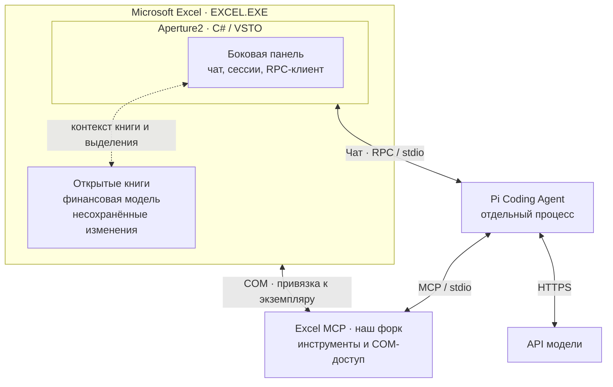

# Aperture2

Личный harness для управления живыми приложениями Microsoft Office через ИИ-агента на базе [Pi Coding Agent](https://github.com/earendil-works/pi).

Первый этап — Excel: пользователь общается с агентом в боковой панели внутри приложения, а агент читает и изменяет открытую книгу через инструменты. Первый прикладной сценарий — **анализ и аудит существующей финансовой модели**. PowerPoint и Word входят в дальнейшее направление проекта.

## Статус

На 14 октября 2026 года зафиксированы требования и рабочая архитектурная схема. Пользователь выбрал C# / VSTO и уточнил, что реализация, запуск и проверки выполняются на этой машине силами агента. Для первого рабочего варианта выбран подход с готовым Excel MCP и его доработкой; стартовый кандидат — ThepExcelMCP. Окончательный выбор зависимости требует проверки живого Excel. В этом репозитории реализации и команд запуска Aperture2 пока нет.

У пользователя есть отдельный приватный прототип с 40+ инструментами (количество сообщено пользователем). Передавать его сюда сейчас не планируется. Возможен последующий перенос оболочки Aperture2 и подключение этих инструментов на другой машине. Это дополнительный путь переиспользования, а не условие работы текущего проекта: здесь нужен собственный работоспособный комплект с доступным backend. Код прототипа не исследован; по предоставленному скриншоту видны только некоторые контракты, поэтому совместимость и объём доработок пока неизвестны.

## Подтверждённые решения

- Агентная основа — Pi Coding Agent из `earendil-works/pi`.
- Pi отвечает за агентный цикл ReAct, взаимодействие с моделью и провайдерами, сетевое взаимодействие в рамках агентного runtime и выполнение цикла вызовов инструментов. Aperture2 не реализует собственный параллельный агентный движок.
- Aperture2 предоставляет интерфейс, связывает его с сессиями Pi и обеспечивает доступ к инструментам Office.
- Основной интерфейс первого этапа — боковая панель внутри Excel. Пользователь выбрал **C# / VSTO**, а не Office.js.
- Главная задача — управление живым приложением Excel и открытыми в нём книгами, включая их текущее несохранённое состояние. Обработка отдельного файла на диске сама по себе эту задачу не решает.
- Первый пользовательский сценарий — анализ и аудит существующей финансовой модели.
- Обычные изменения выполняются сразу по запросу в чате. Подтверждение нужно для удаления, закрытия и других рискованных действий; обязательное согласование каждого изменения не требуется.
- Excel реализуется первым. Интеграции PowerPoint и Word откладываются до следующих этапов.

## Рабочая схема интеграции

**VSTO работает внутри приложения Excel, а книги принадлежат этому же экземпляру приложения.** Для первого варианта Pi подключает внешний Excel MCP, который выполняет операции через COM. Это позволяет сохранить готовую реализацию инструментов и доработать её под нашу привязку к Excel. VSTO отвечает за панель, контекст пользователя и связь с Pi; отдельный дублирующий исполнитель инструментов внутри VSTO на старте не нужен.

RPC обслуживает разговор с Pi, MCP — вызовы инструментов. COM-связь внешнего backend адресуется к тому экземпляру Excel, в котором работает панель. Книги не являются внешним сервисом или частью надстройки. MCP — граница подключения реализации, а не требование использовать сервер без модификаций.

| Часть | Ответственность |
| --- | --- |
| Боковая панель VSTO | Чат, результаты, подтверждения рискованных действий и переход к ячейкам |
| Клиент Pi и управление сессиями в VSTO | Запуск Pi, асинхронный RPC, привязка чата к экземпляру Excel и книге |
| Pi Coding Agent | Агентный цикл, контекст сессии, провайдеры и вызовы инструментов |
| Excel MCP backend | Схемы и выполнение инструментов, точная привязка к Excel и книге, последовательное выполнение COM-операций |

В первой версии отдельный сервер-координатор не нужен: управление Pi выполняют асинхронные службы надстройки. Сетевое ожидание и чтение потоков Pi не блокируют UI. Собственные обращения VSTO к объектной модели выполняются в UI-потоке; внешний COM-backend соблюдает свою модель STA и маршалинга. VSTO использует .NET Framework, а внешний сервер может сохранять свой runtime — например, Python у ThepExcelMCP.

Позже backend может стать собственным MCP-сервером или MCP-адаптером к инструментам внутри VSTO. Во втором случае понадобится локальный канал, например named pipe. Эти изменения касаются исполнения инструментов; панель и управление Pi-сессиями сохраняют свои обязанности. Совместимость конкретных схем инструментов обеспечивается адаптацией, а не предполагается автоматически.

## Запуск Pi и сессии

Основа первого прототипа — **RPC-режим Pi**, на который пользователь указал через [документацию pi.dev](https://pi.dev/docs/latest/rpc). Надстройка запускает Pi по требованию через CLI и сохраняет процесс на время активного чата. Для MVP — один процесс Pi на активный чат; история сессии хранится средствами Pi.

1. VSTO запускает Pi и обменивается командами, ответами и потоковыми событиями JSONL через stdin/stdout.
2. Pi подключает Excel MCP как дочерний stdio-сервер. До выполнения операций backend должен подтвердить привязку к экземпляру Excel и книге, выбранным в панели.
3. Когда Pi вызывает инструмент, MCP-backend выполняет его через COM в целевом Excel и возвращает результат агенту. У панели нет второго независимого пути изменять книгу агентными инструментами.
4. Завершение или перезапуск Pi не закрывает Excel и не уничтожает несохранённую книгу. При завершении чата освобождаются только принадлежащие ему дочерние процессы и соединения.

RPC через stdin/stdout сам по себе не является сетевым сервером. Постоянный фоновый хост можно добавить позже, если понадобятся сессии, живущие независимо от Excel. В первой версии он не предусмотрен.

Чат получает явную привязку к `excelInstanceId` и `workbookId`. Эти идентификаторы действуют в пределах текущего запуска; имя файла и `ActiveWorkbook` не заменяют идентичность цели. Смена активного окна не меняет цель выполняющейся задачи. После закрытия книги или перезапуска Excel привязку нужно восстановить явно.

Протокол Pi: [RPC](https://pi.dev/docs/latest/rpc) для разговора с агентом и [MCP](https://pi.dev/docs/latest/mcp) для инструментов. Перед реализацией необходимо закрепить версии Pi и backend и проверить их API. Механизм начальной привязки backend к Excel ещё нужно реализовать и проверить; произвольный `GetActiveObject` без проверки цели недостаточен.

## Инструменты: переиспользование и трудозатраты

**Рабочая рекомендация после уточнений пользователя — здесь сделать запускаемый комплект VSTO + Pi + доработанный Excel MCP, а приватные инструменты оставить возможной последующей заменой.** Стартовый кандидат — [ThepExcelMCP](https://github.com/ThepExcel/ThepExcelMCP) с сохранением его Python backend. Это сокращает объём переноса кода; окончательно принимать зависимость следует после проверки целевой книги и нужных операций на этой машине. Допустимы полный форк, выделение библиотеки, перенос отдельных операций и сочетание с собственным кодом. VSTO не обязывает писать инструменты с нуля.

На скриншоте прототипа видны `excel_workbook_overview`, `excel_get_values_in_range`, `excel_read_range_visible_values_as_md_table`, `excel_count_non_empty_cells`, `excel_set_value_in_cell` и `excel_set_values_horizontal`. В контрактах указаны handles книг, координаты диапазонов, обработка объединённых ячеек, подсчёт средствами Excel и возврат значений после записи. Это свидетельство описанного интерфейса, а не проверка реализации, полного покрытия или надёжности.

Предварительная оценка ниже относится к дополнительной работе над инструментами для первого сценария аудита. Панель, интеграция с Pi и общие проверки нужны при любом варианте и не должны повторно учитываться как недостаток одного из них. Уровни относительные; это не оценка сроков в днях.

| Вариант | Дополнительные трудозатраты | Когда имеет смысл |
| --- | --- | --- |
| Подключить приватные инструменты пользователя | Неизвестны; потенциально небольшие при совместимости интерфейсов | Последующая интеграция на другой машине; сейчас исходники недоступны и не могут быть основой локального запуска |
| Перенести выбранные C#-операции из `sbroenne/mcp-server-excel` | Средние для ограниченного набора: зависимости, контекст выполнения, COM lifetime и совместимость с .NET Framework | Если не хватает нескольких сложных операций, а свой исполнитель уже есть |
| Форкнуть `sbroenne/mcp-server-excel` целиком | Скорее высокие для небольшого MVP: изменить владение Excel/книгами и проверить все затронутые пути | Если нужно широкое покрытие его функций и выгодно сохранить большую часть backend во внешнем процессе |
| Форкнуть `ThepExcel/ThepExcelMCP`, сохранив Python backend | Средние: готовые операции остаются, но нужны точная привязка к приложению, политика запуска и корректное поведение при тайм-аутах | Стартовый кандидат для локального MVP без переписывания готового каталога инструментов |
| Переписать Python/Go backend на C# целиком | Высокие: значительная часть реализации и проверок переносится заново | Только при отдельном обосновании; это не дешёвое копирование кода |
| Написать небольшой набор новых C#-операций | Небольшие для простых адресных операций, растущие для полного покрытия и надёжности | Для конкретных пробелов, если это дешевле переноса; недоступность приватного кода не должна блокировать нужную здесь функцию |

Основание оценки по исследованным исходникам:

- В [sbroenne Core](https://github.com/sbroenne/mcp-server-excel/blob/9b6e5bbd3d212f85dfd55cfb4c8e9dc727a04999/src/ExcelMcp.Core/ExcelMcp.Core.csproj) указан .NET 10; [операции диапазонов](https://github.com/sbroenne/mcp-server-excel/blob/9b6e5bbd3d212f85dfd55cfb4c8e9dc727a04999/src/ExcelMcp.Core/Commands/Range/RangeCommands.Values.cs) получают `IExcelBatch`. Это полезная граница для адаптации, но не готовая совместимость с VSTO. Его жизненный цикл Excel нужно оценивать отдельно от самих операций.
- В [ThepExcel session.py](https://github.com/ThepExcel/ThepExcelMCP/blob/bd3aac3e188c3f1277f8694b12b00c128db773db/src/thepexcel_mcp/session.py) уже есть COM-очередь и подключение к Excel, но используются активное приложение/книга и поиск по имени; предусмотрен автоматический запуск Excel, а тайм-аут ожидания не удаляет вызов из очереди. Это конкретные места доработки форка под Aperture2.
- При переносе кода сохранять сведения об источнике, ревизии и применимые лицензионные уведомления. Не переносить автоматически чужие политики сохранения, закрытия и завершения Excel.

Стоимость сравнивается целиком: изучение чужого кода + адаптация зависимостей и жизненного цикла + интеграция + проверки на живом Excel + дальнейшая поддержка. Для узкого сценария большая кодовая база может стоить дороже нескольких новых операций; при широком покрытии полный форк может окупиться.

Оболочку следует отделить от каталога и реализации инструментов через MCP. Достаточны описание инструмента и аргументов, выполнение с явной целью Excel/книга, результат или ошибка, признаки изменяющего/рискованного действия. Для первой версии использовать и адаптировать схемы выбранного доступного backend; не ждать приватных контрактов. При подключении другой библиотеки предпочтительна тонкая обёртка. Универсальную систему плагинов заранее не строить.

В показанной выше схеме VSTO получает контекст своего `Application`, а MCP-backend выполняет инструменты. Необходимы единый порядок операций и точная идентичность книги; два независимых контроллера не должны конкурировать за запись. Тестовый исполнитель допустим для разработки UI, но не является результатом MVP: запуск и приёмка здесь должны включать реальный Excel и доступные здесь инструменты.

Необходимое покрытие первого сценария: описание книги и листов, чтение значений и формул диапазона, чтение имён и ошибок, переход к ячейкам; затем явные запись и пересчёт с повторным чтением результата. Наличие этих операций в приватном прототипе за пределами показанного скриншота пока неизвестно.

Наличие MCP-протокола не доказывает работу с живой пользовательской книгой: проверяется поведение исполнителя. MCP здесь обеспечивает интерфейс инструментов для Pi и возможность подключения других клиентов в будущем.

## Предлагаемый первый прототип

Следующие пункты — рабочее предложение для проверки архитектуры, а не уже реализованные функции:

1. Открыть тестовую финансовую модель в Excel и показать боковую панель Aperture2.
2. Создать сессию Pi, отправить запрос на аудит и получить ответ в панели.
3. Через инструменты прочитать структуру книги, формулы и значения выбранных диапазонов, включая несохранённые изменения.
4. Вернуть замечания с точными ссылками на листы и ячейки. Место хранения отчёта — чат, отдельный лист или другой вариант — ещё выбрать.
5. По отдельному запросу пользователя внести небольшое изменение в тестовую книгу, выполнить пересчёт и прочитать результат обратно.
6. Проверить остановку задания и корректное поведение при занятости Excel, смене активной книги или потере подключения.

Аудит сам по себе не означает разрешение автоматически исправлять исходную модель. Изменения должны соответствовать запросу пользователя.

## Критерии проверки интеграции

- Агент работает с нужной книгой в нужном процессе Excel; переключение активного окна не перенаправляет уже начатую операцию на другую книгу.
- Проверка включает реальные чтение, запись, пересчёт и повторное чтение. Успешного запуска процесса и получения списка инструментов недостаточно.
- Сохранение и закрытие проверяются отдельно на тестовой книге; несохранённые изменения пользователя не теряются.
- Если инструмент временно меняет `Calculation`, `ScreenUpdating` или `EnableEvents`, он восстанавливает прежние значения, в том числе при ошибке.
- Учитываются пакетные операции, занятость Excel и локаль формул. Успех чтения данных не подменяет визуальную проверку интерфейса.

## Открытые вопросы

- Способ установки VSTO-надстройки, версия и разрядность настольного Excel, конкретный UI toolkit панели.
- Версии Pi и backend, механизм привязки внешнего MCP к нужному Excel и книге, обработка разрыва соединения и восстановления сессии.
- Подключение приватных инструментов на другой машине, совместимость их интерфейса с оболочкой и недостающее покрытие аудита.
- Выбор между форком backend, переносом отдельных компонентов и новой реализацией конкретных недостающих операций с учётом суммарных трудозатрат.
- Работа одного чата с несколькими книгами и восстановление привязки после повторного открытия книги.
- Формат результата аудита и способ перехода от замечания к ячейке.
- Модели, провайдеры, способ авторизации и необходимость внешнего поиска или загрузки данных сверх обращения к модели.
- Точная граница рискованных операций, механизм подтверждения и способ восстановления после неудачной записи.

Инструкции для работающих с репозиторием агентов находятся в [AGENTS.md](AGENTS.md).
